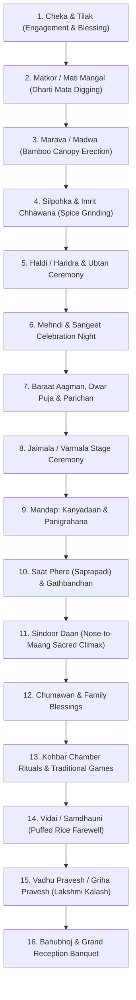

# Reference 07: Chronological Assembly & Raw Footage Ingestion Pipeline

When handling 6 to 7 hours of raw video (100–200 GB across 500 to 1,000 individual camera files), systematic ingestion and chronological assembly prevent post-production chaos.

---

## 1. Directory & Ingestion Architecture

Organize your storage drive into the standard production structure:

```
[Project_Root_Groom_Bride]
├── 01_Raw_Footage/
│   ├── Cam_A_Main_FX3/
│   │   ├── Day1_Cheka_Tilak/
│   │   ├── Day2_Matkor_Haldi/
│   │   ├── Day3_Sangeet/
│   │   └── Day4_Wedding_Reception/
│   ├── Cam_B_Candid_A7S3/
│   ├── Cam_C_Drone_Air3/
│   └── Cam_D_Stage_Static/
├── 02_Audio_Master/
│   ├── Live_Field_Recorders (Zoom H6 / Tascam / Wireless Mics)
│   ├── Pandit_Sanskrit_Vedic_Mics
│   ├── Live_Folk_Geet_Raw_Recordings
│   ├── Curated_Soundtracks_Licensed
│   └── Foley_Sound_FX (Bells, Whooshes, Dhol, Wind, Fire)
├── 03_FCPX_Libraries/
│   └── Groom_Bride_Wedding.fcpbundle
├── 04_Exports/
│   ├── 01_Teasers/
│   ├── 02_Trailers/
│   ├── 03_Highlights/
│   └── 04_Master_Films/
└── 05_Backups_Archive/
```

---

## 2. Master Chronological Ritual Pipeline

Raw footage must be assembled in strict cultural and narrative sequence:



---

## 3. The 5-Phase Editing Assembly Workflow

### Phase 1: Ingestion, Transcoding & Proxy Generation
* Import all clips into Final Cut Pro.
* If editing on laptop hardware or handling 4K 10-bit 4:2:2 footage, generate **ProRes Proxy** (50% resolution) to maintain buttery-smooth playback during multi-cam scrubbing.
* Run audio waveform synchronization across all camera angles (Cam A, Cam B, Stage Cam, Audio Recorder) to create automatic **Multicam Clips** for ceremonies like Jaimala, Mandap, and Sangeet.

### Phase 2: Metadata Tagging & Hero Clip Selection
* Scrub through each clip at 2x speed using `J-K-L` keyboard navigation.
* Set In (`I`) and Out (`O`) points on usable segments.
* Tag with Smart Keywords:
  * `RITUAL_MATKOR`, `RITUAL_HALDI`, `RITUAL_SINDOOR`, `RITUAL_VIDAI`, etc.
  * `HERO_SMILE`, `FAMILY_VIP`, `DRONE_ESTABLISHING`, `BROLL_DECOR`.

### Phase 3: The Assembly Cut (Storyline Build)
* Build the primary storyline by placing selected clips in chronological order.
* Do not worry about music sync or transitions yet; focus on narrative clarity, cultural completeness, and verifying that both bride and groom families have balanced representation.

### Phase 4: The Fine Cut (Rhythm, Ramping & Beat Syncing)
* Lay down the master soundtrack and licensed mashups.
* Drop markers on the beats.
* Snip clips to sync with downbeats, apply speed ramping (fast-in, slow-motion-out), and polish cut-on-action transitions.

### Phase 5: Color Grading, Sound Design & Final Polish
* Balance exposure and white balance using Color Wheels.
* Protect Indian skin tones along the vectorscope flesh line.
* Apply film grain, subtle halation on jewelry/lights, and ritual-specific LUTs.
* Clean live folk geet vocals using spectral isolation; balance background music ducking against vows and pandit mantras.
* Export high-bitrate master (ProRes 422 or H.265 Master 4K @ 50 Mbps).
