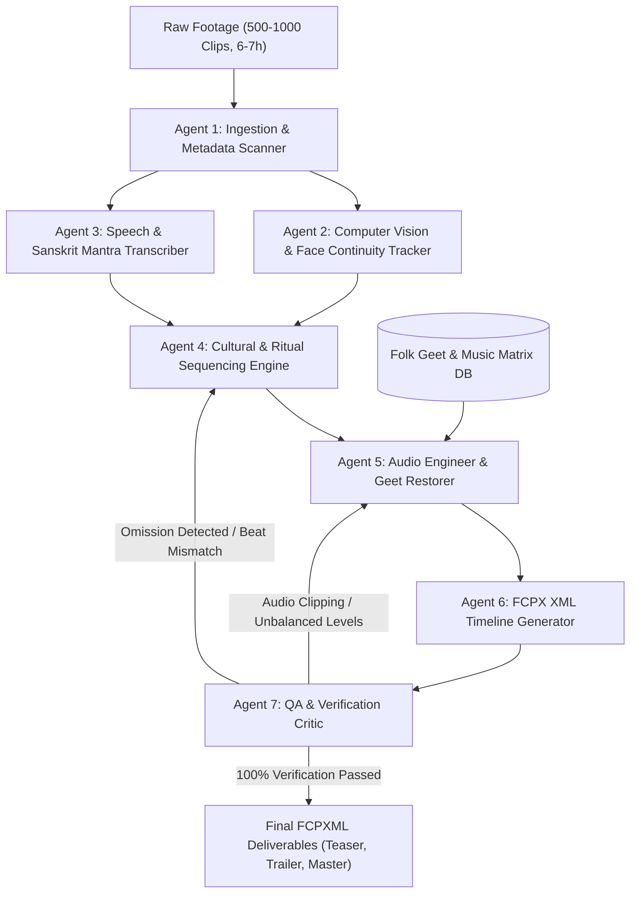

# Reference 09: Multi-Agent Graph Architecture & Verification Loops

To reliably process complex Indian and Bihari weddings with 500 to 1,000 raw video clips (6 to 7 hours of footage, 100–200 GB), the editing pipeline is organized as an **Agentic Directed Graph** with autonomous specialization, feedback loops, and strict quality verification.

---

## 1. Graph Topology & Node Specialization

---

## 2. Agent Node Responsibilities

### Node 1: Ingestion & Metadata Scanner Agent (`ingest_agent`)
* Recursively scans raw storage drives.
* Extracts video container metadata (resolution, frame rate, duration, codec, audio channel layout) via `ffprobe` / `avprobe`.
* Generates SHA-1 persistent clip IDs.
* Populates `clips.jsonl` and creates the organized event taxonomy.

### Node 2: Computer Vision & Face Continuity Agent (`face_agent`)
* Runs lightweight facial detection and appearance clustering across representative video frames.
* Assigns character tags: Bride (`B01`), Groom (`G01`), Bride's Parents (`BF01`, `BM01`), Groom's Parents (`GF01`, `GM01`), Siblings (`SIB01-04`), VIPs.
* Generates character presence heatmaps to ensure no key family member is neglected.

### Node 3: Audio Transcription & Mantra Agent (`transcribe_agent`)
* Extracts audio streams (16 kHz mono WAV).
* Runs speech-to-text to detect spoken vows, emotional blessings by parents, and Sanskrit Vedic mantras.
* Flags high-value emotional voiceover soundbites with precise millisecond timecodes.

### Node 4: Cultural Sequencing & Ritual Engine (`sequence_agent`)
* Classifies clips into the 16 chronological Bihari wedding phases (Matkor -> Marava -> Haldi -> Sangeet -> Tilak / Dwar Puja -> Jaimala -> Mandap -> Sindoor Daan -> Kohbar -> Vidai -> Griha Pravesh -> Reception).
* Enforces the 3-Act narrative structure for Trailers and chronological documentary integrity for Master Films.

### Node 5: Audio Engineer & Geet Restorer (`audio_agent`)
* Restores raw live courtyard folk singing (*Matkor Geet*, *Hardi Hardiya*, *Samdhauni*) using spectral denoising and 80 Hz high-pass filtering.
* Balances background music beds against vows and pandit chanting using automated audio ducking (-16 dB).
* Matches video cut points to musical beats, snares, and drops.

### Node 6: Final Cut Pro (FCPXML) Generator (`fcpxml_agent`)
* Synthesizes all edit decisions into an Apple Final Cut Pro XML interchange file (FCPXML v1.10).
* Generates primary storylines, secondary connected audio storylines, multicam synchronizations, markers, and color board attributes.

### Node 7: Critic & QA Verification Agent (`qa_verifier`)
* Runs strict automated validation tests:
  1. **Character Presence Test**: Did both sets of parents appear in the trailer and master cut?
  2. **Ritual Completeness Test**: Are all mandatory rituals (Sindoor Daan, Matkor, Jaimala, Vidai) present?
  3. **Pacing & Beat Test**: Do cut points align with musical downbeats?
  4. **FCPXML Schema Test**: Does the generated XML pass DTD validation without syntax errors?
* If any test fails, feedback is routed back to the offending agent in an automated correction loop.

