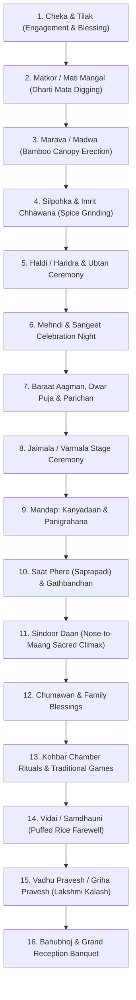
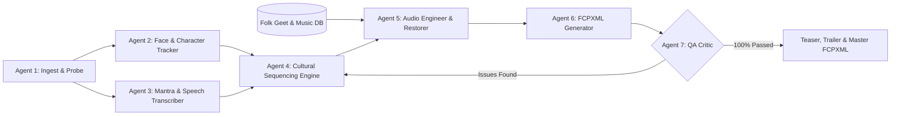

# 🎬 Bihari & Indian Wedding Video Editing Framework

[](https://opensource.org/licenses/MIT)
[](https://www.python.org/)
[](https://support.apple.com/final-cut-pro)
[](#multi-agent-graph-architecture)

> **The definitive open-source intelligence and automation framework for editing Indian and Bihari wedding films.**  
> Built to transform **6 to 7 hours of raw multi-camera footage (100–200 GB across 500–1,000 clips)** into broadcast-grade cinematic films, trailers, and comprehensive documentaries in **Apple Final Cut Pro (FCPX)**.

---

## 🌟 Why This Framework Exists

Traditional Indian weddings—especially across **Bihar, Patna, Mithila, Magadh, and Bhojpuri cultural zones**—are ancient, multi-day sacred rites rich in unique folk rituals (*Matkor*, *Marava*, *Silpohka*, *Sindoor Daan from nose tip*, *Kohbar*, *Vidai*). 

Standard commercial wedding templates fail because they lack:
1. **Sacred Chronology Awareness**: Missing the 16 distinct ritual phases and their cultural weight.
2. **Folk Audio Restoration**: Inability to clean up live women's singing (*Mahila Mandali Lokgeet*) recorded in noisy brick courtyards.
3. **Character Continuity Tracking**: Risk of omitting key family members (grandparents, maternal uncles, in-laws) across 1,000 raw clips.
4. **Specific Color Science**: Western LUTs distort Indian skin tones along the vectorscope flesh line and blow out turmeric yellow (*Haldi*) and vermilion red (*Sindoor*).

This framework solves these challenges with an autonomous, graph-based multi-agent architecture and native Apple Final Cut Pro XML (FCPXML v1.10) automation.

---

## 🏛️ The 16 Bihari Ritual Sequence (Master Chronology)



---

## 🤖 Multi-Agent Graph Architecture

The framework coordinates specialized autonomous agent nodes operating in an iterative feedback and quality verification loop:



1. **Ingest & Probe Agent**: Scans 500–1000 clips, extracts video codecs/framerate/duration, and creates persistent SHA-1 clip IDs.
2. **Face & Character Tracker Agent**: Audits presence of Bride, Groom, Parents, Siblings, and VIPs; enforces balanced screen time.
3. **Audio Engineering Agent**: Applies 80 Hz HPF, 50 Hz notch, 320 Hz mud cut, and -16 dB adaptive ducking for Sanskrit mantras.
4. **FCPXML Generator Agent**: Builds valid Apple Final Cut Pro XML v1.10 project files.
5. **QA Critic Agent**: Automatically validates that no family member is missing, beat markers align, and schema is error-free.

---

## 📦 Deliverables Produced

| Deliverable | Target Duration | Editing Grammar | Audio Treatment | Output File |
| :--- | :--- | :--- | :--- | :--- |
| **Cinematic Teaser** | 1 – 3 Minutes (90s standard) | Rapid cuts (0.5–1.5s), speed ramps (800% to 25%), beat drops, cliffhangers | High-energy beat sync, bass impact drops | `Bihari_Wedding_Teaser_1080p.fcpxml` |
| **Cinematic Trailer** | 5 – 10 Minutes (6–8m sweet spot) | 3-Act narrative: Roots -> Grandeur -> Sacred Vows & Vidai | 2–3 track mashup + emotional vow voiceovers | `Bihari_Wedding_Trailer_Cinematic.fcpxml` |
| **Master Feature Film** | 1 – 3 Hours (Full Documentary) | Chronological documentary, multi-camera sync, complete rituals, reception queue | Live courtyard folk geet, Sanskrit mantras, acoustic bed | `Bihari_Wedding_Master_Documentary.fcpxml` |

---

## 🚀 Quick Start Guide

### 1. Installation
Clone the repository and install lightweight Python dependencies:
```bash
git clone https://github.com/your-username/bihari-indian-wedding-film-editor.git
cd bihari-indian-wedding-film-editor
pip install -r requirements.txt
```

### 2. Ingest Raw Footage (500–1,000 Clips)
```bash
python3 scripts/raw_footage_ingest.py --root /path/to/raw_footage --work ./my_wedding_job
```

### 3. Audit Character Continuity & Family Balance
```bash
python3 scripts/family_face_tracker.py --work ./my_wedding_job
```

### 4. Generate Apple Final Cut Pro (FCPXML) Timelines
```bash
python3 scripts/fcpxml_generator.py --type all --out ./my_wedding_job/out
```

### 5. Execute Full Multi-Agent Graph Loop
```bash
python3 scripts/agent_graph_orchestrator.py --work ./my_wedding_job
```
Double-click the generated `.fcpxml` files to open the fully assembled, color-coded, beat-synced timelines directly in **Apple Final Cut Pro**!

---

## 📚 Reference Manuals

* [`references/01_video_styles_and_durations.md`](./references/01_video_styles_and_durations.md) — Teaser, Trailer, and Master Film visual taxonomy.
* [`references/02_editing_color_audio_fcpx.md`](./references/02_editing_color_audio_fcpx.md) — FCPX color grading, skin tone vectorscope alignment, and speed curves.
* [`references/03_indian_wedding_music_matrix.md`](./references/03_indian_wedding_music_matrix.md) — Soundtrack matrix across Haldi, Mehndi, Sangeet, Jaimala, and Vidai.
* [`references/04_bihari_rituals_complete_guide.md`](./references/04_bihari_rituals_complete_guide.md) — Cultural encyclopedia of all 16 Bihari rituals.
* [`references/05_bihari_folk_geet_and_mantras.md`](./references/05_bihari_folk_geet_and_mantras.md) — 29 traditional Maithili/Bhojpuri Vivah Geet (Sharda Sinha) and Sanskrit mantras.
* [`references/06_family_tracking_and_reception_guide.md`](./references/06_family_tracking_and_reception_guide.md) — Multi-character tracking and reception 3-cut rhythm.
* [`references/07_chronological_assembly_pipeline.md`](./references/07_chronological_assembly_pipeline.md) — Storage directory architecture and 5-phase assembly.
* [`references/08_video_library_150.md`](./references/08_video_library_150.md) — Curated master database of 165 analyzed YouTube wedding films and tutorials.
* [`references/09_agent_graph_architecture.md`](./references/09_agent_graph_architecture.md) — Autonomous agent graph topology and verification loops.

---

## 🤝 Attribution & Credits

> **Built with Cloud AI for wedding filmmakers and video editors worldwide.**  
> Special homage to **Padma Bhushan Sharda Sinha** for immortalizing the cultural soul and folk songs of Bihar.  
> Open-source under the [MIT License](LICENSE). Contributions, additions to the video reference library, and regional adaptations are welcome!

